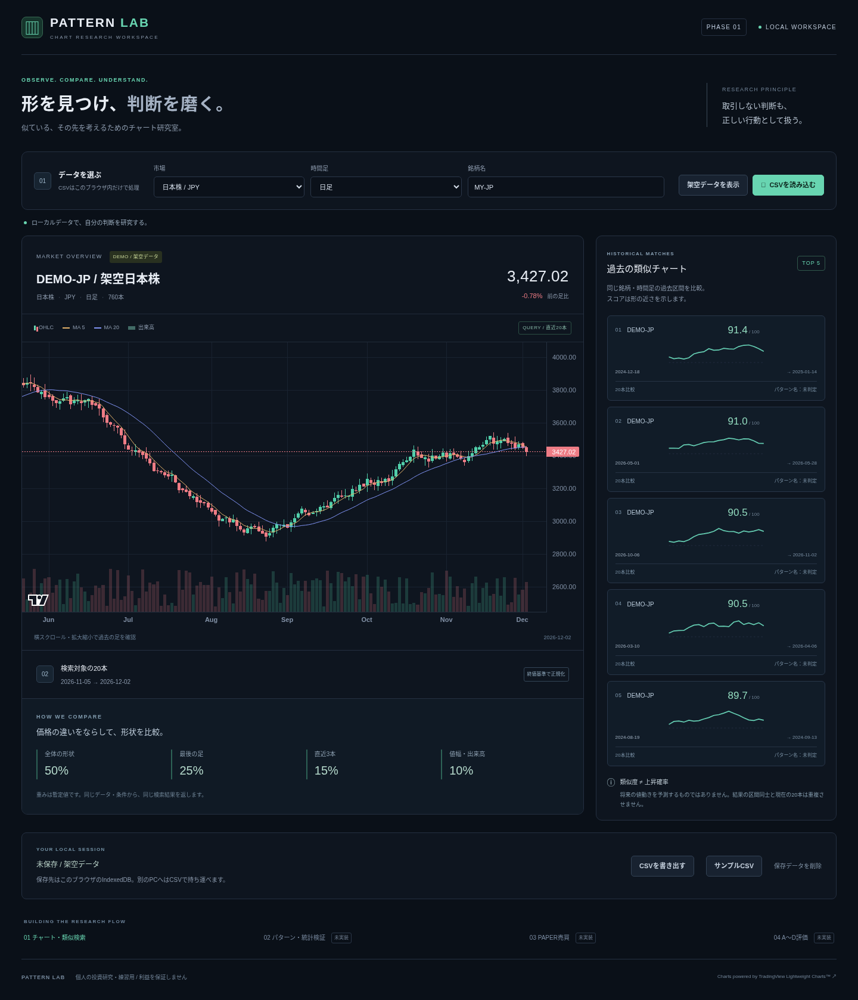

# PATTERN LAB

## ブラウザで開く

**アプリURL：[PATTERN LAB](https://pattern-lab.minikun130.chatgpt.site)**

Sitesで本人限定公開しています。アプリの利用にNode.jsのインストールは不要です。同じChatGPTアカウントでログインしてください。GitHubはソース保存先、上のリンクは動作中のアプリです。CSVはブラウザ内で処理・保存し、PC間で自動同期しません。

CSVで株式チャートの形を比較する、個人向けローカル研究アプリ。Phase 1を実装しています。

**無料構成 / 実注文なし / 有料APIなし / CSV外部送信なし。**

## 自宅のWindows PCで起動

Node.js 22以降（推奨24 LTS）とGitをインストールし、PowerShellで実行します。

```powershell
git clone https://github.com/mininni031-cmyk/anndasi.git
cd anndasi
npm ci
npm run dev
```

ブラウザで http://localhost:3000 を開きます。終了はターミナルで `Ctrl+C`。

すでに取得してある場合は、変更を保存したうえで `git pull`、`npm ci`、`npm run dev`。
Gitを使わない場合はGitHubの **Code → Download ZIP** で取得し、展開したフォルダで `npm ci` と `npm run dev` を実行できます。

初回のNode.js・依存パッケージ取得にはネット接続が必要です。取得後はローカルデータで主要機能を利用できます。Webフォント、外部データAPI、外部AIを必要としません。TradingViewのクレジットリンクを開く場合はネット接続を使います。

## まず試す

1. 初期画面では「DEMO-JP / 架空日本株」の日足760本を表示します。
2. メインチャートでローソク足、MA5・MA20、出来高を確認します。スクロールと拡大縮小に対応します。
3. 右側に直近20本と似た過去区間を最大5件表示します。
4. 「市場」「時間足」「銘柄名」は次に読み込むCSVの情報です。設定変更だけでは現在のチャートを変更しません。
5. 「サンプルCSV」は選択市場の架空データを出力します。日本株は日足、米国株は1分足です。対応する市場・時間足に合わせて読み込んでください。
6. 自分のCSVを読み込むと、外部送信せずブラウザ内で検証・検索・保存します。
7. 「CSVを書き出す」で現在のOHLCVを持ち運べます。銘柄名・市場・時間足はCSVに含まないので、別PCで再指定してください。

保存先は **このブラウザ・このアクセス先のIndexedDB** です。クラウド同期やGitHubへのCSV自動保存はしません。localhostと127.0.0.1、別ポート、別ブラウザは別保存領域です。現在の1データセットを保存し、新しいデータの読込で置き換えます。初期デモは未保存です。「保存データを削除」で保存を消して日本株デモへ戻ります。保存失敗時もメモリ上で利用できますが、再読込で失われる旨を表示します。

## CSV仕様

UTF-8（BOM可）、カンマ区切り、CRLF/LF、引用符に対応。最大10 MiB・100000本。空行は無視します。

```csv
time,open,high,low,close,volume
2026-01-05,2400,2440,2380,2420,150000
2026-01-06,2420,2450,2400,2440,180000
```

- 必須列は `time,open,high,low,close,volume`。列順は変更できます。追加列は解析に使用しません。
- 日足のtimeは `YYYY-MM-DD`。
- 分足は `2026-01-05T09:30:00-05:00` や `2026-01-05T14:30:00Z`。秒は00、ミリ秒は省略または000。内部はUTC秒です。
- 有効な暦日、有限の正のOHLC、有限の非負の出来高が必要です。欠損・重複時刻・高安不整合は行番号とともにエラーにし、読込全体を拒否します。
- 時刻は昇順に整列します。休場日やセッションは自動補完・検証しません。データの調整価格・出来高の定義は利用者が揃えてください。
- 少ない本数でもチャートを表示できます。分析には20本、比較候補には合計40本以上が必要です。上位5件を必ず得られるとは限りません。

## 検索の意味と限界

直近20本をクエリとし、それ以前の同じデータセットの20本区間を検索します。クエリと候補、採用された結果同士は重複しません。

価格を最初の終値からの比率に変換して区間スケールで正規化し、全体形状50%・最後の足25%・直近3本15%・値幅と出来高10%で距離を合成します。スコアは `100 / (1 + 加重距離)`。同点は時刻昇順です。

**スコアは形状の近さであり、上昇確率・投資助言・利益の保証ではありません。** 重みは暫定値で最適化されていません。架空データには休場日・企業イベント等の正確な市場情報を含めません。

Phase 1ではパターン名、将来騰落率、統計・期間外検証、リプレイ、A〜D評価、RISK GUARD、仮想口座、売買ジャーナルは未実装です。実注文機能はありません。全体の計画は [原本v3](docs/reference/pattern-lab-v3.md)、実装範囲は [Phase 1設計](docs/superpowers/specs/2026-10-16-pattern-lab-phase1-design.md) と [STATUS](docs/STATUS.md) を参照してください。

## 検証

```powershell
npm test
npm run typecheck
npm run build
npx playwright install chromium
npm run test:e2e
```

既存のChromiumを使う場合はPowerShellで `$env:CHROMIUM_PATH="C:\path\to\chrome.exe"` を設定できます。未設定ならPlaywrightでインストールしたChromiumを使います。

本番起動は `npm run build` → `npm start`。ビルド・開発ともNext.jsのWebpack方式を使用します。

GitHubには原本・設計・コード・ロックファイル・テスト・起動手順を保存します。node_modules、ビルド出力、利用者のCSV、ブラウザ保存領域、認証情報は含めません。

## チャートライセンス

Charts powered by [TradingView Lightweight Charts™](https://www.tradingview.com/)。Lightweight ChartsはApache-2.0。チャート内のTradingViewロゴと画面下部のリンクを表示しています。依存ライブラリのライセンスはそれぞれのパッケージに従います。

数値計算は価格・出来高の最大値で先にスケールし、有限値の入力同士で割り算や移動平均がオーバーフローしないようにしています。異常に大きい相対値幅の特徴量は `1e12` で飽和させます。通常の市場価格でのスコアを確率として校正する処理ではありません。


